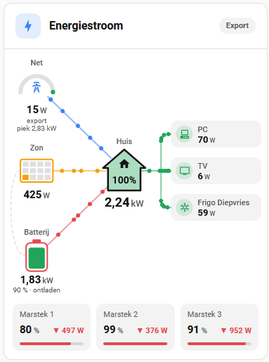

# Home Energy Flow Card

[](https://github.com/Toolifybe/ha-power-flow-card)
[](https://hacs.xyz)

Animated energy flow card for Home Assistant (formerly *Power Flow Card*). Visualises real-time energy flows between solar panels, grid, battery, home and individual consumers.

<p align="center"></p>

## Features

- Animated flow dots showing direction and source of energy
- Flows are calculated from the energy balance (solar, grid, battery), home consumption is calculated when no `home_entity` is set
- Any MDI icon via Home Assistant's own icon set
- Sensors in W, kW or MW (power) and Wh, kWh or MWh (energy) are converted automatically
- Clean, flat look that follows your Home Assistant theme (light and dark)
- Header with a live summary (e.g. "Zon 390 W · batterij laadt · net 2,01 kW") and a grid status pill
- Stable card height — grows with the most consumers that were on at the same time, but does not shrink each time one switches off
- Consumers with 0 W are automatically hidden and re-appear when active
- Debounce protection: prevents consumers from flickering during brief sensor glitches
- Capacity tariff: grid turns orange near and red above your peak limit, with the monthly peak shown under the grid
- Separate tiles per battery (state of charge and power), e.g. for multiple Marstek Venus batteries
- Optional battery shape instead of a circle: fills up with the state of charge (red, orange, green) and shows a bolt while charging
- Tap any circle, consumer or battery tile to open the standard Home Assistant more-info dialog with history
- Configurable colours, labels, title and icon via YAML

---

## Installation

### Via HACS (recommended)

1. Open HACS in Home Assistant
2. Go to **Frontend**
3. Click the **⋮** menu → **Custom repositories**
4. Add `https://github.com/Toolifybe/ha-power-flow-card` with category **Lovelace**
5. Search for **Home Energy Flow Card** and click **Download**
6. Hard-refresh your browser (Ctrl+Shift+R)

HACS handles copying the file, registering the resource and future updates automatically.

### Manual installation

1. Download `power-flow-card.js` from the [latest release](https://github.com/Toolifybe/ha-power-flow-card/releases/latest)
2. Copy it to `/config/www/community/ha-power-flow-card/`
3. Delete any existing `.gz` file in that same folder
4. Go to **Settings → Dashboards → Resources** and add `/local/community/ha-power-flow-card/power-flow-card.js` (type: JavaScript module)
5. Hard-refresh your browser (Ctrl+Shift+R)

---

> **Upgrading from Power Flow Card?** `type: custom:power-flow-card` keeps working, unless another card
> (such as ulic75/power-flow-card) already uses that name. Switch to `custom:home-energy-flow-card` when convenient.

## Minimal configuration

```yaml
type: custom:home-energy-flow-card
solar_entity: sensor.solar_power
grid_entity: sensor.grid_power
```

Home consumption is calculated as solar + grid import + battery discharge − export − battery charge.
Only set `home_entity` if you have a sensor that measures exactly that.

---

## Full configuration

```yaml
type: custom:home-energy-flow-card
title: Energy Flow            # default: Energiestroom; use false to hide the header
icon: mdi:lightning-bolt      # header icon

# ── Sources ────────────────────────────────────────────────────────────────────
solar_entity: sensor.envoy_current_power_production
grid_entity: sensor.elektriciteit_meter_power
# Optional: without it, home consumption is calculated from the other sensors
# home_entity: sensor.home_consumption

# Single battery
battery_entity: sensor.battery_power

# OR multiple batteries (values are summed)
battery_entities:
  - sensor.marstek_venus_modbus_ac_power
  - sensor.marstek_venus_modbus_ac_power_2
  - sensor.marstek_venus_modbus_ac_power_3

# State of charge via direct sensor
battery_soc_entity: sensor.battery_soc

# OR state of charge calculated from stored energy / capacity
battery_stored_energy_entities:
  - sensor.marstek_venus_modbus_stored_energy
  - sensor.marstek_venus_modbus_stored_energy_2
  - sensor.marstek_venus_modbus_stored_energy_3
battery_capacity_kwh: 15.36

# OR state of charge per battery (same order as battery_entities)
# battery_soc_entities:
#   - sensor.battery_1_soc
#   - sensor.battery_2_soc

# Tiles per battery below the diagram (shown when there are 2+ battery_entities).
# State of charge per battery comes from battery_soc_entities, or from
# battery_stored_energy_entities ÷ (battery_capacity_kwh ÷ number of batteries).
battery_names:
  - Marstek 1
  - Marstek 2
  - Marstek 3
# show_batteries: false   # hide the tiles

# Battery drawn as a battery that fills up with the state of charge instead of a circle:
# red below 20 %, orange below 50 %, green above; a bolt while charging. Default: circle.
# battery_style: battery

# ── Capacity tariff ────────────────────────────────────────────────────────────
# Grid turns orange at peak_warn_percent of the limit and red above it.
peak_entity: sensor.monthly_peak          # shown as "piek …" under the grid
peak_limit: 2680                          # W; or use peak_limit_entity
# peak_limit_entity: input_number.peak_limit
peak_warn_percent: 90                     # default 90

# ── Polarity ───────────────────────────────────────────────────────────────────
# grid_inverted:
#   false (default) = positive value means grid import, negative means export
#   true            = negative value means grid import, positive means export
grid_inverted: false

# battery_inverted:
#   true (default)  = positive means discharging, negative means charging (Marstek/Victron)
#   false           = negative means discharging, positive means charging
battery_inverted: true

# ── Debounce ───────────────────────────────────────────────────────────────────
# Number of seconds a consumer must read 0 W before it disappears.
# Prevents consumers from flickering due to brief sensor glitches.
# Default: 8. Set to 0 to hide immediately.
debounce_seconds: 8

# ── Minimum power ──────────────────────────────────────────────────────────────
# Flows smaller than this (W) are not animated. Prevents the grid flow from
# flipping direction around 0 W. Default: 10.
min_power: 10

# ── Colours ────────────────────────────────────────────────────────────────────
# Any CSS colour, including theme variables such as var(--accent-color).
colors:
  solar:     '#f59e0b'    # default
  grid:      '#3b82f6'    # default
  battery:   '#e5484d'    # default
  home:      'var(--primary-text-color)'   # default
  consumers: '#22a55a'    # default for all consumers

# ── Labels ─────────────────────────────────────────────────────────────────────
# Display name shown above each node circle.
labels:
  solar:   Solar         # default: Zon
  grid:    Grid          # default: Net
  battery: Battery       # default: Batterij
  home:    Home          # default: Huis

# ── Individual consumers ───────────────────────────────────────────────────────
# Consumers at 0 W are hidden automatically and reappear when active.
# Active consumers are dynamically centred alongside the home node.
# Without icon: a plug icon is shown. Without color: colors.consumers is used.
entities:
  - entity: sensor.sonoff_xxx_power
    name: PC
    icon: mdi:desktop-classic

  - entity: sensor.sonoff_xxx_power
    name: TV
    icon: mdi:television

  - entity: sensor.sonoff_xxx_power
    name: Dishwasher
    icon: mdi:dishwasher

  - entity: sensor.sonoff_xxx_power
    name: Washing machine
    icon: mdi:washing-machine

  - entity: sensor.sonoff_xxx_power
    name: Dryer
    icon: mdi:tumble-dryer

  - entity: sensor.sonoff_xxx_power
    name: Boiler
    icon: mdi:water-heater
```

---

## Configuration reference

| Option | Type | Default | Description |
|--------|------|---------|-------------|
| `title` | string / `false` | `Energiestroom` | Header title; `false` hides the header |
| `icon` | string | `mdi:lightning-bolt` | Header icon |
| `solar_entity` | entity | — | Solar power sensor (W) |
| `grid_entity` | entity | — | Grid power sensor (W) |
| `home_entity` | entity | calculated | Home consumption sensor (W). Leave out to calculate it |
| `battery_entity` | entity | — | Battery power sensor (W) |
| `battery_entities` | list | — | List of battery sensors (summed) |
| `battery_soc_entity` | entity | — | Battery state of charge sensor (%) |
| `battery_stored_energy_entities` | list | — | Stored energy sensors (Wh or kWh) |
| `battery_capacity_kwh` | number | — | Total battery capacity in kWh |
| `battery_soc_entities` | list | — | State of charge per battery (%) |
| `battery_names` | list | `Batterij 1…` | Names for the battery tiles |
| `show_batteries` | bool | `true` | Show a tile per battery (2+ batteries) |
| `peak_entity` | entity | — | Monthly peak sensor (W or kW) |
| `peak_limit` | number | — | Peak limit in W |
| `peak_limit_entity` | entity | — | Peak limit from a sensor / input_number (W or kW) |
| `peak_warn_percent` | number | `90` | Grid turns orange from this % of the limit |
| `grid_inverted` | bool | `false` | Invert grid sensor polarity |
| `battery_inverted` | bool | `true` | Invert battery sensor polarity |
| `debounce_seconds` | number | `8` | Seconds at 0 W before a consumer is hidden |
| `min_power` | number | `10` | Flows below this value (W) are not animated |
| `colors.solar` | colour | `#f59e0b` | Solar colour |
| `colors.grid` | colour | `#3b82f6` | Grid colour (also the header icon) |
| `colors.battery` | colour | `#e5484d` | Battery colour |
| `colors.home` | colour | `var(--primary-text-color)` | Home colour |
| `colors.consumers` | colour | `#22a55a` | Default colour for consumers |
| `labels.solar` | string | `Zon` | Solar node display name |
| `labels.grid` | string | `Net` | Grid node display name |
| `labels.battery` | string | `Batterij` | Battery node display name |
| `labels.home` | string | `Huis` | Home node display name |
| `entities` | list | — | Individual consumer nodes |
| `entities[].entity` | entity | — | Power sensor (W) |
| `entities[].name` | string | entity id | Display name |
| `entities[].icon` | string | `mdi:power-plug-outline` | MDI icon (e.g. `mdi:desktop-classic`) |
| `entities[].color` | colour | `colors.consumers` | Consumer colour |

---

## Flow logic

| Situation | Animation |
|-----------|-----------|
| Solar production | Yellow dots: solar → home (solar is used by the home first) |
| Battery charging, solar left over | Yellow dots: solar → battery |
| Battery charging from the grid | Red dots: home → battery |
| Grid import | Blue dots: grid → home |
| Grid export | Blue dots: home → grid |
| Battery discharging | Red dots: battery → home |
| Consumer active | Green dots: home → consumer |
| Source not active | Grey circle with a dashed line |
| Grid import near / above peak limit | Grid turns orange / red, pill shows *Bijna piekgrens* / *Boven piekgrens* |
| Consumer at 0 W | Consumer is hidden (with debounce) |

---

## Icons

Every MDI icon that Home Assistant knows can be used, e.g. `mdi:desktop-classic`, `mdi:television`, `mdi:car-electric`, `mdi:heat-pump`, `mdi:washing-machine`, `mdi:water-heater`.
Browse icons at [pictogrammers.com](https://pictogrammers.com/library/mdi/). Consumers without `icon:` show a plug icon.

---

## Layout

```
  ┌ ⚡ Energiestroom ─────────────────────── [Export] ┐
  │ Battery discharging · 27 W to the grid            │
  │                                                   │
  │  (Grid)                       ┌[PC        80 W]   │
  │  (Solar) ────── (Home) ───────┼[TV        46 W]   │
  │  (Battery)                    └[Dryer     48 W]   │
  └───────────────────────────────────────────────────┘
```

- Sources are stacked in the left column: grid top, solar middle, battery bottom
- Home sits in the centre, consumers are tiles on the right
- The card is as high as needed for the sources and for the most consumers that were on at the same time since the page was loaded, so it does not shrink each time one switches off
- When a consumer drops to 0 W it disappears (after `debounce_seconds`); the remaining ones re-centre on the home node

---

## Troubleshooting

**Card does not load / `customElements` error**
→ Delete the `.gz` file next to the `.js` in `/config/www/community/ha-power-flow-card/` and hard-refresh. For HACS installs, try re-downloading via HACS.

**Values are incorrect**
→ Check the raw sensor values in Developer Tools → States. Verify that `grid_inverted` and `battery_inverted` match your hardware's sign convention.

**Consumer keeps flickering in and out**
→ Increase `debounce_seconds` (e.g. to `15` or `30`) to filter out noisy sensor readings.

**Which version is loaded?**
→ Open the browser console (F12): the card logs `HOME-ENERGY-FLOW-CARD v4.1.1`.

**Colours look like the old version**
→ Remove the `colors:` block from your YAML to use the new default palette.

---

## Changelog

### v4.2.0
- New option `battery_style: battery`: the battery is drawn as a battery that fills up with the state of charge (red below 20 %, orange below 50 %, green above) with a bolt while charging. The default stays the circle.

### v4.1.1
- Shorter header summary ("net 2,01 kW" instead of "2,01 kW van het net" — the pill already shows import/export); a long summary wraps to a second line instead of being cut off

### v4.1.0
- Renamed to **Home Energy Flow Card** (`custom:home-energy-flow-card`) — the old name clashed with ulic75/power-flow-card. `custom:power-flow-card` keeps working when that name is free
- New: capacity tariff — `peak_entity`, `peak_limit` / `peak_limit_entity`, `peak_warn_percent`. Grid turns orange near and red above the limit, the pill shows *Bijna piekgrens* / *Boven piekgrens*
- New: tiles per battery with state of charge, bar and power (▼ discharging, ▲ charging) — `battery_names`, `battery_soc_entities`, `show_batteries`
- New: tap a circle, consumer or battery tile to open the more-info dialog

### v4.0.2
- Fixed: icons were not centred in their circles in the Home Assistant companion app (WebKit places `foreignObject` content wrongly in a scaled SVG). Icons now sit in an HTML layer above the drawing and scale with the card

### v4.0.1
- Fixed: large empty space above the diagram when many consumers are configured. The card reserved room for every configured consumer; it now sizes itself to the most consumers that were on at the same time since the page was loaded

### v4.0.0
- New look that matches standard Home Assistant cards: flat circles with a coloured ring, values in the theme text colour with a small grey unit, consumers as tiles
- Uses `ha-card` and Home Assistant theme variables, so light and dark themes work automatically
- New header with icon, title, live summary and an Import / Export / Neutraal pill (`title`, `icon`; `title: false` hides it)
- Inactive sources turn grey with a dashed line; the battery icon follows the state of charge and shows charging
- Fixed card height: no more empty space and no dashboard shifts when consumers switch on or off
- Solar → battery is drawn as an arc beside the column, no longer through the text
- Calmer animation: smaller dots, one shared flow from home to the consumer bus
- New defaults: grid `#3b82f6`, battery `#e5484d`, home follows the text colour, all consumers `colors.consumers` (`#22a55a`), solar label `Zon`
- Colours accept any CSS colour, including theme variables

### v3.2.0
- Fixed: every return to the browser tab added an extra event listener, doubling each time and slowing the browser down over time
- Fixed: `debounce_seconds` counted function calls instead of seconds, so consumers disappeared almost immediately; consumers also disappear now without a new sensor update
- Fixed: consumer layout could be calculated for a different number of consumers than were drawn
- Fixed: home consumption is calculated from the energy balance when no `home_entity` is set
- Fixed: flows are calculated from the energy balance — battery charging is now always shown (from solar and/or grid), solar → home no longer animates when all solar goes elsewhere
- Fixed: sensors in kW/MW and Wh/MWh are converted (stored energy in Wh gave a SOC stuck at 100%)
- Fixed: icons now use Home Assistant's own icon set; several built-in icons were wrong and unknown icons showed an empty circle
- Fixed: animation speed no longer depends on the screen refresh rate (120/144 Hz ran twice as fast)
- Fixed: colours other than `#rrggbb` broke the 3D sphere
- Fixed: unavailable sensors show `–` instead of `0 W`
- Fixed: the card editor showed an empty editor; the YAML editor is used now
- New: `min_power` (default 10 W) — no more flickering flow direction around 0 W
- New: numbers follow the Home Assistant language (e.g. `1,35 kW`)
- Improved: the card only recalculates when one of its own sensors changes

### v3.1.0
- New: 3D sphere look for all nodes — radial gradient fill, drop shadow and glare highlight
- Icons and values now render in white for better contrast on the filled spheres
- Node colours remain fully configurable via `colors:` in YAML

### v3.0.6
- Fixed: animation dots no longer appear in wrong positions on initial load
- Fixed: animation dots are immediately cleared when active consumers change, preventing stray dots during layout transitions

### v3.0.5
- Fixed: card height now correctly scales to fit all active consumers — with 6+ consumers the bottom nodes were clipped outside the card

### v3.0.4
- Fixed: dashed line between solar and battery node is now always visible when both are configured
- Improved: consumer flow paths now use rounded corners instead of sharp right angles
- Improved: animation dots follow the rounded corner paths

### v3.0.3
- Fixed: source nodes (grid, solar, battery) and home node no longer shift position when consumers appear or disappear
- Card height now grows downward only — sources and home stay at their fixed vertical positions at all times

### v3.0.2
- Card height now dynamically adjusts to the number of active consumers — no more excess whitespace when few consumers are active
- Home node vertically re-centres as consumers appear and disappear
- Consumer nodes without an `icon:` now show only the watt value, centred inside the circle (no default fallback icon)

### v3.0.1
- Consumers without an `icon:` in YAML no longer show a default fallback circle icon
- Value text is vertically centred inside the circle when no icon is present

### v3.0.0
- Complete rewrite — stable DOM, no more layout corruption
- Consumers at 0 W are hidden; active consumers auto-centre on home node
- Configurable debounce via `debounce_seconds`
- Configurable node colours via `colors:`
- Configurable node labels via `labels:`
- Solar surplus detection: charges battery only when solar > home consumption
- Correct flow direction for all grid/battery combinations
